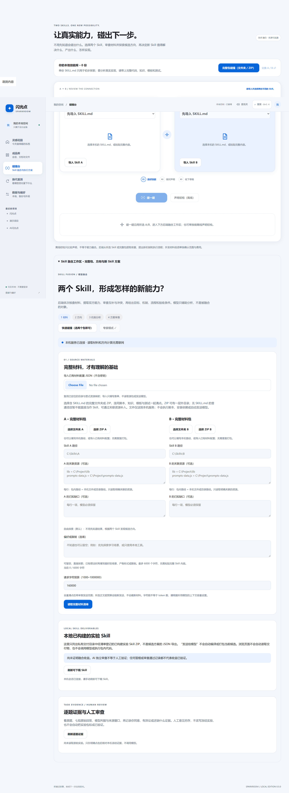
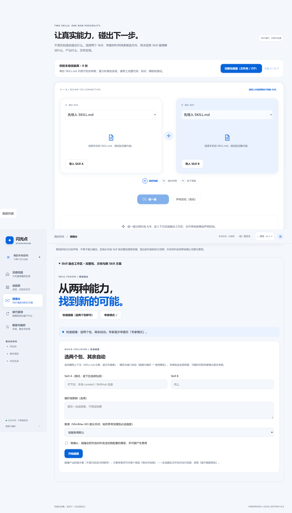
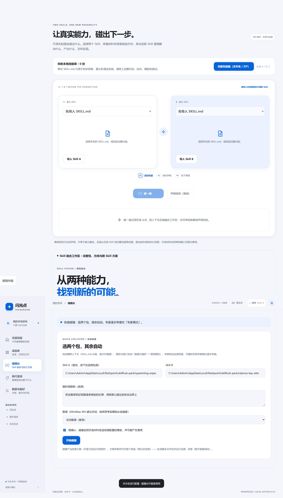
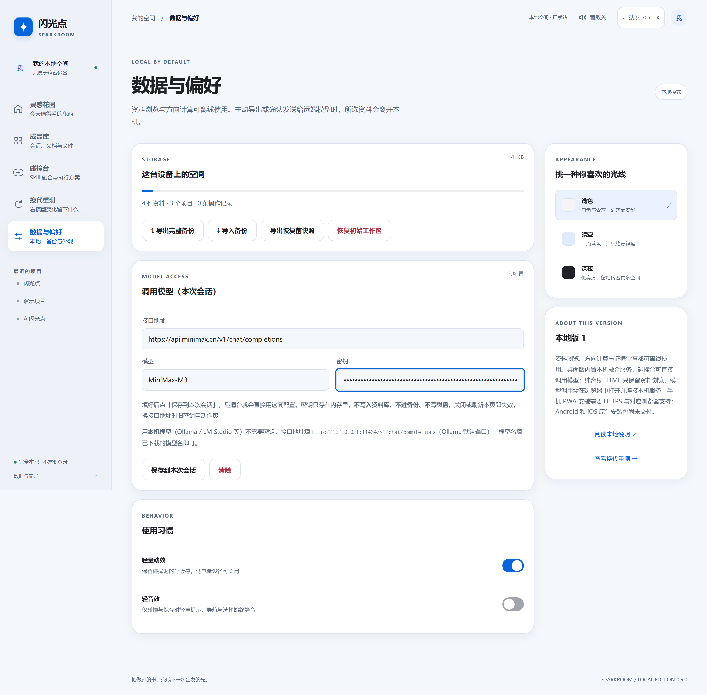
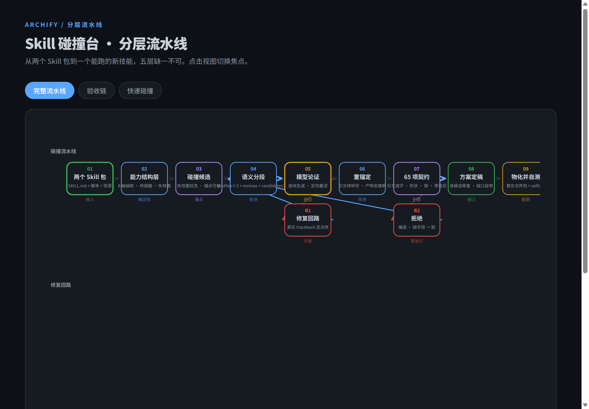

<div align="center">


<h1>AI 闪光点 · Skill 碰撞台</h1>

<p><strong>选两个 Skill 包，碰撞出一个新能力。</strong></p>

<p>本地优先 · 逐字引文可核 · 能跑得动才算数 · 方案不装完整，缺口自己列</p>

<p>个人开源项目 by <a href="https://github.com/KratosLee-6">KratosLee</a> · 默认中文 · 离线确定性引擎 · AI 可选增强</p>

</div>

<div align="center">

[](VERSION.md)
[](LICENSE)
[](app/fusion/)
[](app/)
[](pyproject.toml)

[快速开始](#-快速开始) · [怎么工作的](#-它是怎么工作的) · [实测数据](#-实测数据) · [物化并自测](#-物化并自测) · [架构](#-架构)

</div>

---


<p align="center"><b>融合工作区</b>（快速碰撞面板 · 选两个包 → 一次确认 → 等结果）</p>

## ▶ 演示

> 视频演示制作中。将展示从选包到物化自测的完整流程。

- **[快速碰撞 · 三步](#-快速碰撞)** — 选包 → 确认 → 出方案
- **[物化并自测](#-物化并自测)** — 方案生成真实文件包，selftest 退出码判定
- **[A/B 对照 · n=16 两臂](#-实测数据)** — 整份 0/32 vs 分段 23/25

---

## 🆕 快速碰撞（核心体验）

**选两个包，其余自动。**

<table>
<tr>
<td width="50%"><br><b>下拉选包 → 勾一次确认 → 开始碰撞</b><br>上下文自动精简（SKILL.md 必留，逐文件留痕）；模型与接口来自设置页一次性配置。</td>
<td width="50%"><br><b>已填状态</b><br>目标、推理开关、费用确认——只需要这三个决策。</td>
</tr>
</table>

碰撞产出的是方案。方案之后还有两段工序：

<table>
<tr>
<td width="50%"><br><b>融合工作区（专家模式）</b><br>逐候选审查：贡献来源、证据链、反证检查、评估计划。</td>
<td width="50%"><br><b>模型设置</b><br>多协议支持（OpenAI / Anthropic / Gemini / 本机），密钥仅本次会话内存。</td>
</tr>
</table>

---

## ✨ 核心能力

### 📦 物化并自测

**方案不算数，能跑才算数。** 碰撞完成后，一键物化：生成真实文件包（脚本、模板、schema），自动生成 selftest（合成数据调用包内真实代码），退出码判定。不过的，真实报错带回去定点修，修完重考。

### 🔬 可核验

每条证据都是母包里的**逐字引文**，带文件路径、行号和 SHA-256。引文重锚定修转写误差（0.95/0.90 双阈值，唯一命中才归位），编造引文零容忍。65 项契约条件逐一执行。

### 📦 缺口自己列

方案哪里证据不足、还差什么才能落地，由碰撞方案自己列出来（`needs_ai_fill` + `gaps_to_fill`）——不装完整。对第 5 类候选，可以发起补足请求，模型带缺口清单再答一次，补完由同一个核对器复评。

### 🎨 签名特效

WebGL 极光底纹 + 碰撞火花粒子（确定性 LCG 布局），三重门控（动效设置 / reduced-motion / JS motionOk），WebGL 不可用静默降级。

---

## 🏗 它是怎么工作的

不依赖模型"理解"两个 Skill 的语义——而是用**确定性算法**做四件事：

📊 **可视化分层架构图**：[docs/architecture.html](docs/architecture.html)



### 1. 能力结构抽取

从每个 Skill 包中提取 8 个与领域无关的结构轴：

> 步骤 · 条件 · 约束 · 校验 · 交付物 · 证据引用 · 边界 · 受众

法律包和汽修包可以零共同词汇，但都有步骤和约束。

### 2. 碰撞落点计算

在结构轴的交集上找碰撞机会——**失效面优先**（A 在 B 的某个场景下没有可援引规则），退化为机制配对。每个碰撞候选都带**可锚定的抓手**（母包里的逐字原文），不是空洞的"你们可以合作"。

### 3. 分段生成 + 逐段校验

方案拆成自洽块（2 个能力画像 + 方向审查 + 3 个候选方案），每块独立生成、独立校验。引文重锚定修转写误差，产物名推断补扩展名，证据编造零容忍。

### 4. 物化为真实文件包

通过验收的方案生成真实文件包（脚本、模板、schema），再让包给自己出题——selftest 退出码判定「能不能跑得动」。

---

## 📊 实测数据

### A/B 对照（同材料同模型各 16 次）

| | 通过率 | 说明 |
|---|---|---|
| 一次性输出完整方案 | **0/32** | 写两万字必崩 |
| 分段 + 逐段校验 + 定向重试 | **23/25** | 错哪补哪，只重试坏的那块 |

> 差距不在模型变聪明——在工序。把"一次写对两万字"换成"每块考完再拼"。

### 跨域碰撞（4 个 SkillHub 包 × 本地包，全部 accepted）

<details>
<summary>展开查看碰撞产出</summary>

| 包对 | 候选 A | 候选 B | 候选 C |
|---|---|---|---|
| 🛡 防骗话术 × 证据采集 | 防骗证据采集与可信度判别系统 | 可信证据采集与评估系统 | 风险感知证据收集系统 |
| 🎨 润色去AI味 × 防刷计分 | 防刷信号驱动的文本质量门禁 | 防刷信号驱动的文本质量门禁 | 信号增强的事实核查提纲生成器 |
| 👨‍👩‍👧 育儿顾问 × 设备密钥证明 | 证据驱动提纲验证器 | 提纲事实验证系统 | 事实验证系统 |
| 💻 编程助手 × 默认拒绝权限 | AI编码助手操作权限管理系统 | AI编码助手权限控制系统 | AI编码助手权限管理融合系统 |
</details>

### 物化 selftest

| 融合包 | 检查项 | 结果 |
|---|---|---|
| 育儿顾问 × 设备密钥证明 | 11 | ✅ 全过 |
| 润色去AI味 × 防刷计分 | 14 | ✅ 全过 |
| 编程助手 × 默认拒绝权限 | 14 | ✅ 全过 |

---

## 🧪 测试 Skill 包

以下 Skill 包用于碰撞测试（从 [SkillHub](https://skillhub.cn/skills?sortBy=score) 下载）：

| 包 | 领域 | 大小 |
|---|---|---|
| anti-fraud | 防骗话术识别 | 185 KB |
| libai | 中文润色去 AI 味 | 286 KB |
| parenting-expert | 育儿顾问 | 657 KB |
| dev-expert | 编程专家 | 1 MB |

本地 curated 包：

| 包 | 领域 |
|---|---|
| anti-cheat-scoring | 防刷信号计分 |
| consent-default-deny | 默认拒绝授权 |
| device-key-attestation | 设备密钥证明 |
| evidence-collector | 证据采集 |
| outline-writer | 写作提纲 |
| sandbox-design-discipline | 沙箱权限设计 |

---

## 🚀 快速开始

### 前端（零构建，打开即用）

```bash
cd app
python -m http.server 8080
# 打开 http://localhost:8080
```

### 融合服务（Python 后端）

```bash
pip install Pillow

python tools/serve-local.py --port 4178
# 打开 http://127.0.0.1:4178/app/
```

### 桌面安装包

```bash
cd packages/shell
npm install && npm run build && npm run sidecar
npx tauri build
# 安装包在 src-tauri/target/release/bundle/nsis/
```

### 模型配置

在「数据与偏好 → 调用模型」里配置接口地址、模型名和密钥。仅本次会话内存，不落盘。

| 协议 | 服务商 |
|---|---|
| OpenAI | GPT / DeepSeek / MiniMax / 零一万物 / Kimi |
| Anthropic | Claude |
| Gemini | Google Gemini |
| 本机模型 | Ollama / LM Studio（不需要密钥） |

---

## 🧪 测试

```bash
# Python 融合引擎（660+ 条）
python -m pytest app/fusion/ -q

# 前端 Node 测试（37 条）
node --test app/runtime.test.cjs app/app.test.cjs app/storage.test.cjs

# Playwright UI（设计规范 + 性能守卫 + 融合工作区）
cd app
npx playwright test tests/ui/design.spec.cjs
npx playwright test --config playwright.fusion.config.cjs
```

---

## 📋 诚实体边界

| ✅ 已验证 | ❌ 未验证 |
|---|---|
| 碰撞方案 65 项契约通过 | 比父本技能更好 |
| 证据逐字引文可核 | 新 Skill 长期运行稳定性 |
| 物化包 selftest 可运行 | 商业价值与市场规模 |
| 4 个跨域包对全部 accepted | 更大样本量的统计显著性 |

---

## 🗓 Roadmap

- [ ] 五基线对照实验（效果验证）
- [ ] SkillHub 在线搜索集成
- [ ] 更多模型适配（glm-4.7 / Claude / GPT）
- [ ] 桌面自动更新通道
- [ ] 候选块二段化转正（M3 sweep 失败对 2/2 翻绿，待 n≥16 确认）

---

## 🤝 贡献

欢迎 Issue 和 PR。提交前请跑：

```bash
python -m pytest app/fusion/ -q
node --test app/runtime.test.cjs app/app.test.cjs app/storage.test.cjs
```

---

## 📄 License

[MIT](LICENSE)
