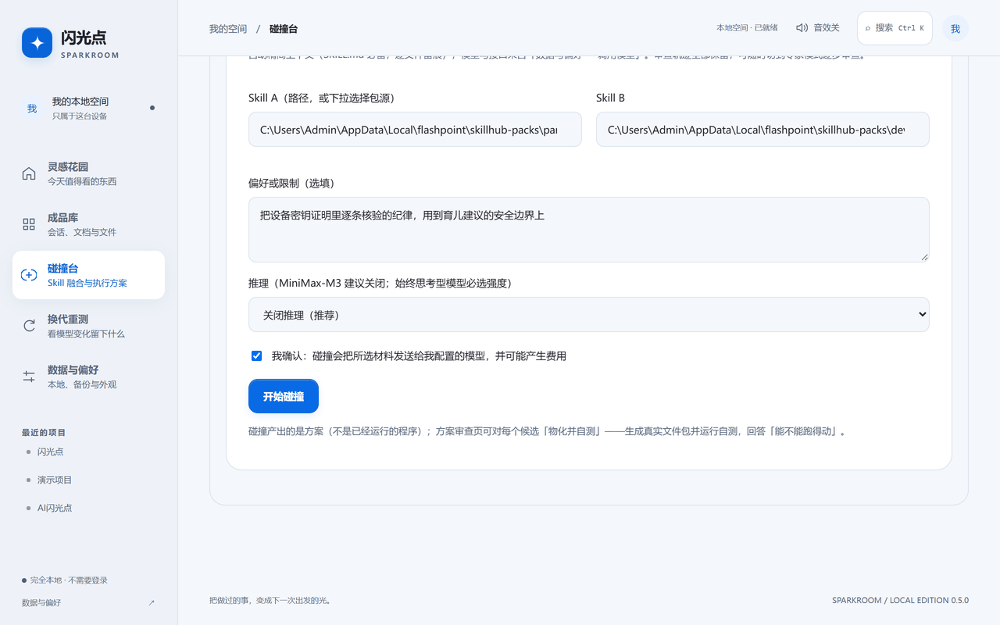
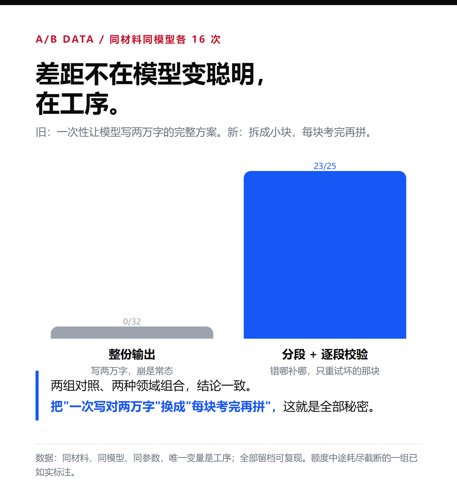

<div align="center">



# ✨ AI 闪光点 · Skill 碰撞台

**选两个 Skill 包，碰撞出一个新能力。**

本地优先 · 逐字引文可核 · 能跑得动才算数

[](VERSION.md)
[](LICENSE)
[](app/fusion/)

[快速开始](#-快速开始) · [怎么工作的](#-它是怎么工作的) · [实测数据](#-实测数据) · [物化](#-物化并自测) · [架构](docs/architecture.html)

</div>

---

## 💡 为什么做这个

你手里有一堆 AI Skill 包——做教育的、做安全审计的、做数据可视化的。

你想过把它们**碰在一起**吗？不是拼接，不是堆砌——是把 A 的方法论嫁接到 B 的场景上，产出两个父本都做不到的新能力。

三周前我试了一次，[翻车了](https://github.com/KratosLee-6/AI--boom)。碰撞结果像两份说明书合订本。

这三周我干了一件事：让它真的能跑。

---

## 🚀 现在怎么用

> 选两个包 → 勾一次确认 → 等几分钟出方案 → 点「物化并自测」→ 拿到一个能跑的文件包

<div align="center">

</div>

界面上只需要选两个包、写一句偏好（可选）、勾一次费用确认。上下文自动精简、格式校验、证据核对全部在后台完成。

需要逐文件审查材料、逐条核对引文？切到**专家模式**，一步一步都在。

---

## 📊 实测数据

### 同一模型 · 同一材料 · 各 16 次

| | 通过率 | 说明 |
|---|---|---|
| 一次性输出完整方案 | **0/32** | 写两万字必崩 |
| 分段 + 逐段校验 + 定向重试 | **23/25** | 错哪补哪，只重试坏的那块 |

> 差距不在模型变聪明——在工序。把"一次写对两万字"换成"每块考完再拼"。

### 四个跨域碰撞包，物化后全部可运行

| 碰撞组合 | 产出 | selftest |
|---|---|---|
| 🛡 防骗话术 × 证据采集 | 来源可信度验证器 | ✅ |
| 🎨 润色去AI味 × 防刷计分 | 文本质量门禁 | ✅ |
| 👨‍👩‍👧 育儿顾问 × 设备密钥证明 | 建议签名 + 防重放 | ✅ 14 项 |
| 💻 编程助手 × 默认拒绝权限 | AI 操作权限扫描器 | ✅ 14 项 |

---

## 🎬 视频演示

> 📹 视频演示制作中——将展示从选包到物化自测的完整流程。

<!-- 
<video src="assets/demo.mp4" controls width="100%"></video>
或

-->

---

## 🔬 它是怎么工作的

不依赖模型"理解"两个 Skill 的语义——而是用**确定性算法**做三件事：

### 1. 能力结构抽取

从每个 Skill 包中提取 8 个与领域无关的结构轴：步骤、条件、约束、校验、交付物、证据引用、边界、受众。法律包和汽修包可以零共同词汇，但都有步骤和约束。

### 2. 碰撞落点计算

在结构轴的交集上找碰撞机会——**失效面优先**（A 在 B 的某个场景下没有可援引规则），退化为机制配对。每个碰撞候选都带**可锚定的抓手**（母包里的逐字原文），不是空洞的"你们可以合作"。

### 3. 分段生成 + 逐段校验

方案拆成自洽块（2 个能力画像 + 方向审查 + 3 个候选方案），每块独立生成、独立校验。引文重锚定修转写误差，产物名推断补扩展名，证据编造零容忍。

### 4. 物化为真实文件包

通过验收的方案生成真实文件包（脚本、模板、schema），再让包给自己出题——selftest 退出码判定「能不能跑得动」。

<div align="center">

</div>

---

## 🏗 架构

📊 **可视化分层架构图**：[docs/architecture.html](docs/architecture.html)（浏览器打开即可查看分层流水线）

```
app/
├── index.html           入口（CSP 严格，无外部依赖）
├── styles.css           三主题：paper / forest / night
├── core.js              数据模型 + 模型访问管理
├── spark-fx.js          签名特效（WebGL 极光 + 碰撞粒子）
├── fusion-ui.js         融合工作区 UI（快速 / 专家双模式）
├── app.js               应用主逻辑（资料库/设置/路由）
└── fusion/              Spark Core 引擎（Python）
    ├── capability.py        能力结构抽取（8 轴 + 桥接 + 失效面）
    ├── collide.py           本地碰撞候选生成
    ├── segments.py          语义分段 + 段级确定性校验
    ├── contract.py          65 项验收契约
    ├── evidence_reanchor.py 引文重锚定（0.95/0.90 双阈值）
    ├── engine.py            编排：prepare → 分段 → 验收链
    ├── materialize.py       方案 → 真实文件包 → selftest
    ├── server.py            HTTP 服务（loopback + 令牌）
    └── ...
```

---

## 🚀 快速开始

### 前端（零构建，打开即用）

```bash
cd app
python -m http.server 8080
# 打开 http://localhost:8080
```

### 融合服务（Python 后端）

```bash
pip install Pillow

python tools/serve-local.py --port 4178
# 打开 http://127.0.0.1:4178/app/
```

### 桌面安装包

```bash
cd packages/shell
npm install && npm run build && npm run sidecar
npx tauri build
# 安装包在 src-tauri/target/release/bundle/nsis/
```

### 模型配置

在「数据与偏好 → 调用模型」里配置接口地址、模型名和密钥。仅本次会话内存，不落盘。支持：

- OpenAI 协议（GPT / DeepSeek / MiniMax / 零一万物 …）
- Anthropic 协议（Claude）
- Gemini 协议
- 本机模型（Ollama / LM Studio，不需要密钥）

---

## 📋 诚实体边界

| ✅ 已验证 | ❌ 未验证 |
|---|---|
| 碰撞方案 65 项契约通过 | 比父本技能更好 |
| 证据逐字引文可核 | 新 Skill 长期运行稳定性 |
| 物化包 selftest 可运行 | 商业价值与市场规模 |
| 4 个跨域包对全部 accepted | 更大样本量的统计显著性 |

---

## 🤝 贡献

欢迎 Issue 和 PR。提交前请跑：

```bash
python -m pytest app/fusion/ -q
node --test app/runtime.test.cjs app/app.test.cjs app/storage.test.cjs
```

---

## 📄 License

[MIT](LICENSE)
