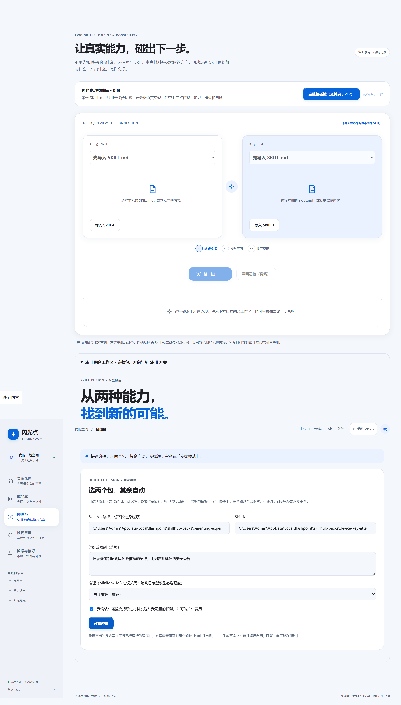

<div align="center">

# ✨ AI 闪光点 · Skill 碰撞台

**选两个 Skill 包，碰撞出一个新能力。**

本地优先 · 可核验 · 能跑得动才算数

[](VERSION.md)
[](LICENSE)
[](app/fusion/)
[](#快速开始)

[功能](#-功能) · [快速开始](#-快速开始) · [它是怎么工作的](#-它是怎么工作的) · [实测数据](#-实测数据) · [架构](#-架构)

</div>

---

## 📸 界面

| 快速碰撞 · 三步出方案 | 融合工作区 · 专家模式 |
|---|---|
|  |  |

| 融合结果 · 逐候选审查 | 物化并自测 |
|---|---|
|  |  |

> 🎬 **视频演示**：*[待插入——用 guizang-product-video-skill 或 huashu-art-motion 生成]*

---

## ✨ 功能

### 快速碰撞

选两个 Skill 包（下拉选择或填路径）→ 勾一次确认 → 等几分钟出方案。上下文自动精简、格式校验、证据核对全部自动，逐文件取舍理由照样留痕。

### 物化并自测

碰撞产出的是方案（纸上的东西）。「物化并自测」把它生成**真实的文件包**（脚本、模板、schema），再让包给自己出题——十几项检查逐条跑，**全过才算数**。不过的，把真实报错带回去定点修。

### 可核验

- 每条证据都是母包里的**逐字引文**，带文件路径、行号和 SHA-256 哈希
- **65 项契约条件**逐一执行：缺字段、编引文、自相矛盾——确定性校验器全部挡下
- 8 个跨域包对实测，**验收零放行**

### 诚实边界

碰撞出的新技能目前验证了「能跑得动」；「比原来的技能更好」还没证明——同任务五基线对照在排期。方案哪里证据不足、还差什么才能落地，由它自己列出来（`needs_ai_fill` + `gaps_to_fill`），**不装完整**。

---

## 🚀 快速开始

### 前端（零构建，打开即用）

直接用浏览器打开 `app/index.html`，或：

```bash
cd app
python -m http.server 8080
# 打开 http://localhost:8080
```

### 融合服务（Python 后端）

```bash
# 安装依赖
pip install Pillow

# 启动融合服务
python tools/serve-local.py --port 4178
# 浏览器打开 http://127.0.0.1:4178/app/
```

### 桌面安装包

```bash
cd packages/shell
npm install
npm run build
npm run sidecar
npx tauri build
# 安装包在 src-tauri/target/release/bundle/nsis/
```

### 模型配置

在「数据与偏好 → 调用模型」里配置接口地址、模型名和密钥（仅本次会话内存，不落盘）。支持 OpenAI / Anthropic / Gemini 协议兼容的端点，以及本机模型（Ollama / LM Studio）。

---

## 🔬 它是怎么工作的

```
选两个 Skill 包
       ↓
┌─ 能力结构层 ── 8 个与领域无关的结构轴（步骤/条件/约束/校验/交付/引用/边界/受众）
│   → 计算桥接面与失效面（A 在 B 的哪个场景下没有可援引规则）
│   → 本地碰撞候选（失效面优先 + 机制配对补齐）
↓
┌─ 语义分段 ── 拆成自洽块（profiles×2 + reviews + candidates×3）
│   → 逐块生成 + 逐块本地确定性校验 + 只重试失败的块
↓
┌─ 验收链 ── 装配 → 填哈希 → 引文重锚定 → 65 项契约全量校验
↓
┌─ 物化 ── 方案 → 真实文件包 → selftest 退出码判定
```

**设计原则**：

- **确定性优先**——碰撞落点由本地算法算出，模型只做具体化
- **先修后判**——引文重锚定修转写误差、产物名推断补扩展名，然后才判
- **分段校验**——每次调用写得更短、错得早、重试得准
- **验收不放松**——编造引文零容忍，65 项契约一道不少

---

## 📊 实测数据

### A/B 对照（同材料同模型各 16 次）

| | 通过 | 失败分布 | 中位耗时 |
|---|---|---|---|
| 整份输出（旧） | **0/32** | shape=30 + json=2 | ~60s |
| 分段 + 逐段校验（新） | **23/25** | segment_rejected=2 | 114s |

> 唯一变量：是否拆段。验收链完全相同。结论跨包成立（两对不同领域组合）。

### 物化 selftest

| 融合包 | 检查项 | 结果 |
|---|---|---|
| 育儿顾问 × 设备密钥证明 | 11 | ✅ 全过 |
| 润色去AI味 × 防刷计分 | 14 | ✅ 全过 |
| 编程助手 × 默认拒绝权限 | 14 | ✅ 全过 |

### 跨域包对（4 个 SkillHub 包 × 本地包，8 组合）

全部 accepted，验收链零放行。

---

## 🏗 架构

```
app/
├── index.html          入口页（CSP 严格，无外部依赖）
├── styles.css          样式（三主题：paper / forest / night）
├── core.js             核心工具（数据模型 + 模型访问管理）
├── skills.js           Skill 数据
├── storage.js          存储层（localStorage + CAS）
├── runtime.js          碰撞动画运行时
├── spark-fx.js         签名特效（WebGL 极光 + 碰撞粒子，三重门控）
├── fusion-ui.js        融合工作区 UI（快速/专家双模式）
├── app.js              应用主逻辑（资料库/设置/路由）
└── fusion/             Spark Core 引擎（Python）
    ├── capability.py       能力结构层（8 轴抽取 + 桥接 + 失效面）
    ├── collide.py          本地碰撞候选（失效面优先，锚点可核）
    ├── segments.py         语义分段（段级指令自动生成 + 确定性校验）
    ├── contract.py         65 项验收契约（含引文逐字核对）
    ├── engine.py           编排：prepare → 分段 → 验收链
    ├── evidence_reanchor.py  引文重锚定（0.95/0.90 双阈值，唯一命中才归位）
    ├── materialize.py      方案物化（哨兵传输 + selftest 修复回路）
    ├── context.py          上下文选择（auto_selection 快速精简）
    ├── server.py           HTTP 服务（loopback，令牌 + 同源校验）
    └── ...
```

---

## 🧪 测试

```bash
# Python 融合引擎（660+ 条）
python -m pytest app/fusion/ -q

# 前端 Node 测试（37 条）
node --test app/runtime.test.cjs app/app.test.cjs app/storage.test.cjs

# Playwright UI（设计规范 + 性能守卫 + 融合工作区）
cd app
npx playwright test tests/ui/design.spec.cjs
npx playwright test --config playwright.fusion.config.cjs
```

---

## 📋 诚实体边界

| 已验证 | 未验证（诚实标注） |
|---|---|
| 碰撞方案 65 项契约通过 | 比父本技能更好（五基线对照在排期） |
| 证据逐字引文可核 | 新 Skill 长期运行稳定性 |
| 物化包 selftest 可运行 | 商业价值与市场规模 |
| A/B 对照 n=16 两臂 | 更大样本量的统计显著性 |

---

## 🗓 Roadmap

- [ ] 五基线对照实验（效果验证）
- [ ] GUI 包源选择增强（SkillHub 在线搜索）
- [ ] 候选块二段化转正（M3 sweep 失败对 2/2 翻绿，待 n≥16 确认）
- [ ] 更多模型适配（glm-4.7 / Claude / GPT）
- [ ] 桌面自动更新通道

---

## 📄 License

[MIT](LICENSE)
